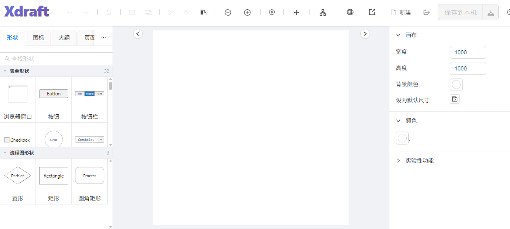

# xdraft

[](./LICENSE)
[](https://www.electronjs.org/)
[](#packaging)

**English** | [简体中文](./README.zh-CN.md)

xdraft is built on top of [mydraft.cc](https://mydraft.cc), the open-source wireframing tool by Sebastian Stehle ([mydraft-cc/ui](https://github.com/mydraft-cc/ui)), as a second-development edition: Electron desktop packaging with offline-first enhancements. It runs on **Windows, Linux (x64 & arm64, incl. UOS/Deepin), and macOS**.

> **Credits & respect**: all core capabilities come from the original open-source project [mydraft-cc/ui](https://github.com/mydraft-cc/ui) (MIT). This is an independent, unofficial distribution maintained by [@duya95555-xs](https://github.com/duya95555-xs); it is not affiliated with or endorsed by the original author. The mydraft name and brand belong to their respective owner.



## Features

- **Desktop app** — Electron packaging for Windows (NSIS installer / portable), Linux (deb / AppImage), macOS (dmg, see below)
- **Offline-first** — icon fonts (Font Awesome / Material Icons) are inlined as base64: no CDN requests, no white screen on offline machines, and exported PNGs keep their icons (font CSS is injected into the exported SVG)
- **Flow connectors** — line style (solid / dashed / dotted), custom color, and per-side arrow heads (none / single / double)
- **UOS-friendly** — optimized slim build (`slim-build.sh`) targeting Debian-based arm64 systems such as UOS
- All wireframing capabilities of the original tool: shapes, icon panels, exported PNG/HTML, localization (zh-CN / en-US)

## Download

Direct downloads (v1.0.2):

| File | Platform | Notes |
|---|---|---|
| [xdraft-Setup-1.0.1-win-x64.exe](https://github.com/duya95555-xs/xdraft/releases/download/v1.0.2/xdraft-Setup-1.0.1-win-x64.exe) | Windows x64 | NSIS installer (choose directory, desktop shortcut) |
| [xdraft-1.0.1-portable-win-x64.exe](https://github.com/duya95555-xs/xdraft/releases/download/v1.0.2/xdraft-1.0.1-portable-win-x64.exe) | Windows x64 | Portable, single file, no installation |
| [xdraft_1.0.2_arm64.deb](https://github.com/duya95555-xs/xdraft/releases/download/v1.0.2/xdraft_1.0.2_arm64.deb) | Linux arm64 (UOS / deepin / Debian) | `sudo dpkg -i xdraft_1.0.2_arm64.deb` |

Newer versions: see the [Releases](https://github.com/duya95555-xs/xdraft/releases) page. Linux x64 / macOS: build locally with the commands in [Packaging](#packaging).

## Development

Requires Node.js ≥ 18.

```bash
npm install        # install dependencies
npm run start      # browser-only dev mode (vite)
npm run electron:dev   # desktop dev mode (vite + electron)
npm run build      # production web build (tsc + vite)
```

> Offline environments: set `ELECTRON_MIRROR=https://npmmirror.com/mirrors/electron/` before `npm install` if the Electron binary download is slow or blocked.

## Packaging

| Platform | Command | Output |
|---|---|---|
| Linux arm64 (UOS/Deepin) | `npm run electron:build:linux-arm64` or `bash slim-build.sh` | deb (xz-compressed) |
| Linux x64 | `npm run electron:build:linux-x64` | deb |
| Windows | `npm run electron:build:win` | NSIS installer / portable |
| macOS | `npx electron-builder --mac` | dmg |

Notes:

- `slim-build.sh` regenerates the inline icon-font data first, builds without `node_modules`, and re-compresses the deb with `xz -9` — the recommended path for UOS.
- macOS packaging has no dedicated npm script yet; run `npx electron-builder --mac` after `npm run build` with `ELECTRON=true`. A `mac` section (dmg target) may be added to `electron-builder-optimized.yml` on demand.
- Build artifacts land in `release-slim/` (see `electron-builder-optimized.yml`).

## Note

This is a personal, best-effort project maintained in spare time. The author's skills are limited, so bugs and rough edges are to be expected — your understanding is appreciated. If you run into one, feel free to [open an issue](https://github.com/duya95555-xs/xdraft/issues), or simply fork and fix it yourself. PRs are always welcome.

## License

[MIT](./LICENSE) — copyright (c) mydraft.cc (Sebastian Stehle) and contributors, plus (c) 2026 duya95555-xs (xdraft edition).
